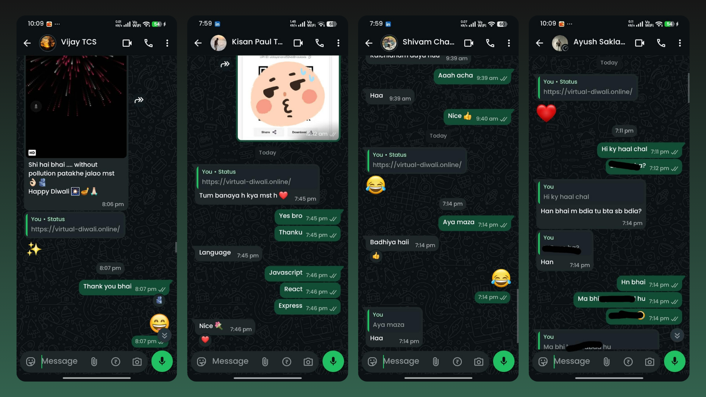

# Virtual Diwali ✨

> *"Miles away from home, yet sharing the same sky. Tonight, we light up the dark together."*

Virtual Diwali is an ultra-minimalist, real-time multiplayer web application designed to bring people together who are celebrating away from home. Users can join a shared dark-sky room, light a personalized Diya, and launch synchronized fireworks with their friends. 

## 📸 The Celebration in Action
*(Here is us enjoying the virtual celebration!)*
 
<!-- Note: Just drop your screenshot image in the repo, name it screenshot.png, and it will show up right here! -->

## 🚀 Features

- **Real-Time Multiplayer:** Powered by Socket.IO, see exactly when your friends join the room, light their Diyas, and launch fireworks in real-time.
- **Kinematic Physics Engine:** A custom HTML5 Canvas particle engine calculates precise gravity and trajectory for the "Sky Burst" rockets, ensuring a realistic 1.5-second ascent before a spectacular, randomized neon burst.
- **Immersive Audio:** Features continuous, atmospheric background music (with a sleek mute toggle) and dynamic, overlapping explosion sounds synced perfectly with the fireworks.
- **Anti-Spam Mechanics:** A built-in 3-second cooldown timer prevents server flooding while giving each launched rocket its moment to shine.
- **Ultra-Minimal UI:** A pure `#020104` dark aesthetic, floating ghost inputs, and a single pulsing spark representing the Diya on the login screen. No passwords, no emails—just pick a username and join the sky.

## 🛠️ Tech Stack

**Frontend:**
* React (Vite)
* Tailwind CSS (for rapid, minimal styling)
* Lucide React (for sleek icons)
* HTML5 Canvas API (for custom particle physics)

**Backend:**
* Node.js & Express
* Socket.IO (for real-time bidrectional event sync)
* SQLite / `better-sqlite3` (for lightweight user persistence)

**Deployment Architecture:**
* **Frontend:** Hosted on the global edge via **Hostinger**.
* **Backend:** Node.js Web Service hosted on **Render**.

## 💻 How to Run Locally

If you want to spin this up on your local machine:

**1. Clone the repository:**
```bash
git clone https://github.com/your-username/virtual-diwali.git
cd virtual-diwali
```

**2. Start the Backend:**
```bash
cd server
npm install
npm start
```
*(The backend will start on http://localhost:3000)*

**3. Start the Frontend:**
Open a new terminal window:
```bash
cd client
npm install
npm run dev
```
*(The frontend will start on http://localhost:5173)*

---
*Built with ❤️ for a brighter, connected Diwali.*